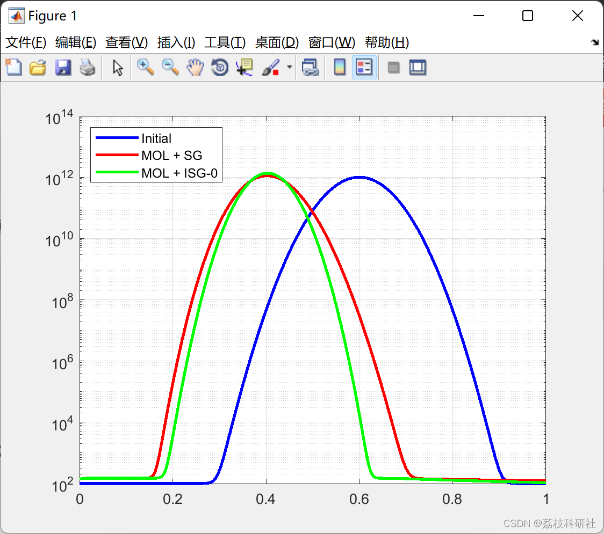

# Computation of fluxes for the convection-diffusion equation based on Sharfetter-Gummel and improved Sharfetter-Gummel (Matlab code)

​  
Editor
Download Link: A More Accurate Scharfetter-Gummel Algorithm for Electron Transport Simulation in Semiconductor and Gas Discharges - ScienceDirect has improved the renowned Scharfetter-Gummmel (SG) scheme for problems dominated by convection in semiconductor and gas discharge plasmas. Considering a one-dimensional convective-diffusive equation, the results show that the original SG scheme is accurate if the potential drop between two adjacent nodes is much less than the electron temperature. To satisfy this condition, a pair of additional nodes are inserted between adjacent nodes. The distance between these "virtual" nodes can be chosen to be sufficiently small to obtain high accuracy at the cell interface. The number density on the virtual nodes is found through interpolation. Tests indicate that the accuracy of this scheme is comparable to FCT technology, but it does not introduce "staircase" interferences due to rapid changes in functionality.
📚2 Running Results Editing
Part of the code:
%% Plot solution in dynamics  
for I=1:100  
semilogy(x, u0, 'b-', x, u1(I,:), 'r-', x, u2(I,:), 'g-', 'LineWidth', 2);  
legend('Initial', 'MOL + SG', 'MOL + ISG-0', 'Location', 'NorthWest');  
xlim([0.0 1.0]);  
grid on;  
pause(0.01)  
drawnow;  
end  
%% MOL ODEs system with SG flux for equation  
%% convection-diffusion equation in 1D (32)  
function [res] = MOL_eqs_SG(t, u)  
global x  
N = length(u);  
% Constants from original paper  
mue = 1.0; De = 1.0; A = 1.0e+4;  
% Linear field  
E = A*x;  
% Define spatial grid steps for non-uniform grid  
h(1:N-1) = x(2:N)-x(1:(N-1)); h(N) = h(N-1); h(N+1) = h(N);  
for k=1:(N-1)  
% Restrict averaged E_{k+1/2} to prevent run-time errors  
if 0.5*abs(E(k+1)+E(k))> eps  
alpha = mue*h(k)/De*0.5*(E(k+1)+E(k));  
I0 = ( exp(alpha) - 1.0 )/alpha;  
j(k+1) = De/h(k)*(u(k) - exp(alpha)*u(k+1))/I0;  
else  
j(k+1) = De/h(k)*(u(k) - u(k+1));  
end  
end  
% Apply simple BCs for fluxes at ghost nodes  
j(1) = -A*x(1)*u(1); j(N+1) = -A*x(N)*u(N);  
% Form MOL ODEs  
k = 1:N;  
res(k) = -(j(k+1)-j(k))./(0.5*h(k)+0.5*h(k+1));  
res = res';  
%% MOL ODEs system with ISG-0 flux for equation  
%% convection-diffusion equation in 1D (32)  
function [res] = MOL_eqs_ISG(t,u)  
global x  
N = length(u);  
% Constants from original paper  
mue = 1.0; De = 1.0; A = 1.0e+4; epsilon = 0.01;  
% Linear field  
E = A*x;  
h(1:N-1) = x(2:N)-x(1:(N-1)); h(N) = h(N-1); h(N+1) = h(N);  
for k=1:(N-1)  
% Distance between virtual nodes h_v (see (21))  
h_v = sqrt(2.0*epsilon*De*h(k)/mue/abs(E(k+1)-E(k)));  
% If h_v>=h then use SG scheme  
if (h_v >= h(k))  
if 0.5*abs(E(k+1)+E(k))> eps  
alpha = mue*h(k)/De*0.5*(E(k+1)+E(k));  
I0 = ( exp(alpha) - 1.0 )/alpha;  
j(k+1) = De/h(k)*(u(k) - exp(alpha)*u(k+1))/I0;  
else  
j(k+1) = De/h(k)*(u(k) - u(k+1));  
end  
% If h_v<h then use ISG-0 (24)-(25)  
else  
if 0.5*abs(E(k+1)+E(k))> eps  
x_L = (x(k)+x(k+1)-h_v)/2;  
x_R = (x(k)+x(k+1)+h_v)/2;  
alpha_v = h_v*mue/De*0.5*(E(k+1)+E(k));  
I0 = ( exp(alpha_v) - 1.0 )/alpha_v;  
j(k+1) = De/h_v*(interp1(x, u, x_L, 'pchip') - exp(alpha_v)*interp1(x, u, x_R, 'pchip'))/I0;  
else  
j(k+1) = De/h_v*(interp1(x, u, x_L, 'pchip') - interp1(x, u, x_R, 'pchip'));  
end  
end  
end  
% Apply simple BCs for fluxes at ghost nodes  
j(1) = -A*x(1)*u(1); j(N+1) = -A*x(N)*u(N);  
% Form MOL ODEs  
k = 1:N;  
res(k) = -(j(k+1)-j(k))./(0.5*h(k)+0.5*h(k+1));  
res = res';  
🌈3 Matlab code implementation
🎉4 References
​  

## Images

<!-- PAYMENT_BLOCK -->

## Get this dataset

- Payment link (Stripe): [Buy now](https://buy.stripe.com/3cs8yP7sY87d0vu9AB)
- Payment QR code: 

<!-- /PAYMENT_BLOCK -->
